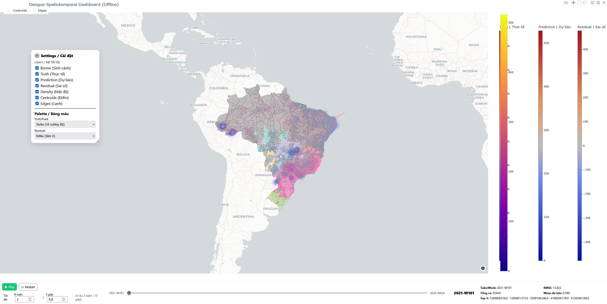
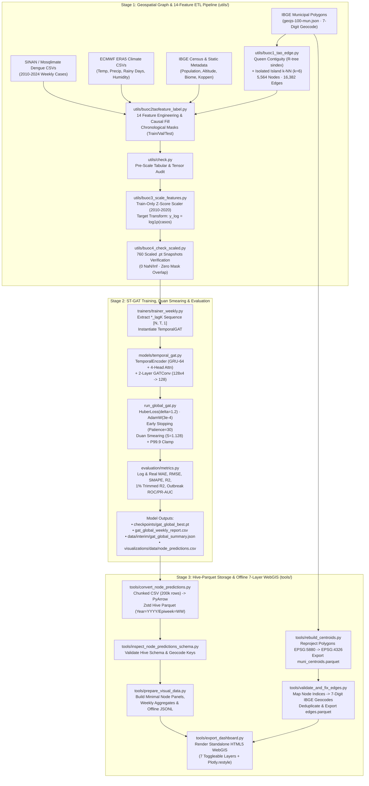
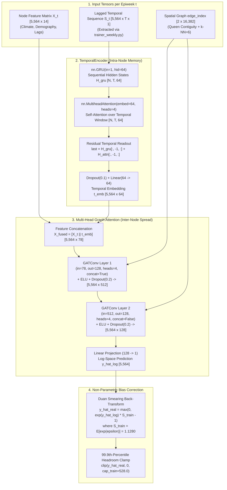

<div align="center">

# 🗺️ Dengue Forecasting & Offline GIS Analytics Platform in Brazil (`ST-GAT`)

### Spatio-Temporal Graph Attention Networks · Hive-Partitioned Apache Parquet · Zero-Server 7-Layer WebGIS (2010–2024)

<p align="center">
  
  
  
  
  
  <a href="https://www.kaggle.com/datasets/lthanhhihunh/sheaf-attention-networks-dengue-fever-in-brazil"></a>
</p>

**Computer Science Capstone Thesis (`Grade: 9.5 / 10` — Top of Cohort) · Ho Chi Minh City Open University**<br>
**Archived at HCMC Open University Library & Officially Registered with the HCMC Department of Science and Technology**<br>
**Author:** Huynh Le Thanh Hai (`Student ID: 2251012054`) · **Supervisor:** Dr. Le Quang Minh<br>
*Clinical Consultation: Infectious Disease Physicians, Hospital for Tropical Diseases (Ho Chi Minh City)*

<p align="center">
  <a href="./checkpoints/gat_global_best.pt"><b>🧠 Pretrained ST-GAT Checkpoint (<code>gat_global_best.pt</code>)</b></a> &nbsp;•&nbsp;
  <a href="./data/interim/gat_global_summary.json"><b>📊 Evaluation Summary (<code>gat_global_summary.json</code>)</b></a> &nbsp;•&nbsp;
  <a href="./gat_global_weekly_report.csv"><b>📈 Weekly Benchmark Log (<code>CSV</code>)</b></a> &nbsp;•&nbsp;
  <a href="./dashboard_chinhthuc.rar"><b>🗺️ Offline WebGIS Package (<code>dashboard_chinhthuc.rar</code>)</b></a> &nbsp;•&nbsp;
  <a href="https://www.kaggle.com/datasets/lthanhhihunh/sheaf-attention-networks-dengue-fever-in-brazil"><b>📦 Kaggle Dataset (4.23M Records)</b></a>
</p>

---

### 🖥️ Production Showcase: Zero-Server Offline Spatio-Temporal GIS Dashboard (`5,564` Municipalities · `16,382` Edges)



</div>

---

## 🔍 Visual Anatomy of the Offline GIS Analytics Platform (`trinhbayduan.png`)

Built via [`tools/export_dashboard.py`](./tools/export_dashboard.py) on top of **Hive-partitioned, Zstandard-compressed Apache Parquet** stores (`4,228,640` municipality-week records), the platform renders a **100% offline, zero-server interactive WebGIS application** directly in the browser using `Plotly.restyle` + `requestAnimationFrame`:

| UI Component in Screenshot | Technical Implementation & Epidemiological Value |
|:---|:---|
| **① 7 Toggleable Spatial Layers**<br>*(Left Floating Panel: `Settings / Cài đặt`)* | Independent visibility toggles with z-order preservation:<br>1. **`Biome (Sinh cảnh)`**: 6 IBGE ecological biomes (Amazônia, Cerrado, Mata Atlântica, Caatinga, Pampa, Pantanal) rendered as a base RGBA layer.<br>2. **`Truth (Thực tế)`**: Observed weekly dengue cases from SINAN/DATASUS.<br>3. **`Prediction (Dự báo)`**: Duan-smearing back-transformed `ST-GAT` forecasts.<br>4. **`Residual (Sai số)`**: Signed prediction error ($\hat{y} - y$) highlighting over-/under-predicted regions.<br>5. **`Density (Mật độ)`**: Kernel spatial density heatmap exposing regional outbreak clusters.<br>6. **`Centroids (Điểm)`**: Surface centroids reprojected from **SIRGAS 2000 Brazil Polyconic (`EPSG:5880`)** to **WGS84 (`EPSG:4326`)**.<br>7. **`Edges (Cạnh)`**: Nationwide **Queen Contiguity + $k\text{-NN}$ ($k=6$)** transmission network (`16,382` undirected edges). |
| **② Dual Adaptive Color Palettes & Non-Overlapping Colorbars**<br>*(Right Triple Colorbars)* | • **`Truth / Prediction` (`Turbo` Palette)**: High-contrast perceptual scale (`0` to `500+` cases) isolating epidemic intensity.<br>• **`Residual` (`RdBu` Zero-Centered Palette, `zmid=0`)**: Diverging scale (`-40k` to `+40k`) immediately distinguishing under-prediction vs. over-prediction.<br>• **Dynamic Right-Margin Layout**: Colorbars automatically reflow as layers are toggled on/off to prevent label collision. |
| **③ Real-Time Temporal Playback Controls**<br>*(Bottom-Left Bar)* | • **`Play / Pause` & `Restart` State Machine**: Driven by `requestAnimationFrame` (zero frame-queue lag).<br>• **Configurable Speed (`N tuần / S giây`)**: Custom step ratio (e.g., `1 week / 0.8s` or `5 weeks / 13s`) with instant timeline scrubbing (`2021-W101` to `2024-W424`). |
| **④ Live Weekly Telemetry & Top-5 High-Risk IBGE Ranking**<br>*(Bottom-Right Readout)* | Dynamically computes weekly KPIs on every frame transition (shown at **`2021-W101`**):<br>• **Weekly Aggregate**: `Tổng ca (Total Cases): 5,354.0` · `RMSE: 13.922` · `Mean dự báo: 0.580`<br>• **Top-5 Outbreak Municipalities (7-Digit IBGE Geocode)**: `1200609: 516.0` · `1200401: 372.0` · `5300108 (Brasília): 246.0` · `4108304 (Foz do Iguaçu): 178.0` · `4126306: 168.0`. |

---

## 📌 Project Overview

Dengue fever transmitted by the *Aedes aegypti* vector exhibits strong **spatio-temporal coupling**: local outbreaks are driven by lagging meteorological conditions (temperature, precipitation variability, humid-heat index) while spreading across municipal borders through human mobility.

This repository contains the complete source code, trained weights, evaluation logs, and offline WebGIS visualization engine for the **Computer Science Capstone Thesis** (*"Dengue Forecasting and Visualization in Brazil Using Spatio-Temporal Graph Attention Networks"*, Student ID: `2251012054`), graded **9.5 / 10 (Top of Cohort)** at **Ho Chi Minh City Open University**:

1. **Nationwide Spatio-Temporal Graph Construction (`5,564` Nodes · `16,382` Edges · `760` Weeks):** Integrates 15 years (`2010–2024`, `4.23M` municipality-week records) of **Mosqlimate / InfoDengue** epidemiological surveillance, **ECMWF ERA5** reanalysis climate series, **IBGE** demographic census tables, and **REGIC 2018 / WGS84 GeoJSON** municipal polygons.
2. **Hybrid `TemporalGAT` (`ST-GAT`) Architecture:** Combines a **GRU + 4-Head Temporal Self-Attention** sequence encoder (capturing lagged intra-municipal dynamics) with a **2-Layer, 4-Head Graph Attention Network (`GATConv`)** (learning anisotropic spatial attention weights across neighboring municipalities), trained with **`HuberLoss(δ=1.2)`** and **`Duan's Smearing` (`S = 1.128`)** log-to-real bias correction.
3. **Strong Out-of-Sample Generalization & Outbreak Early Warning:** Achieves **Validation $R^2_{\log} = 0.7935$ (Trimmed $R^2_{\log} = 0.8311$, $\text{ROC-AUC} = 0.9822$)** on `2021–2022` and **Test $R^2_{\log} = 0.7584$ (Trimmed $R^2_{\log} = 0.7921$, Micro $R^2_{\log} = 0.8044$, $\text{ROC-AUC} = 0.9752$, $\text{PR-AUC} = 0.7839$)** on the unseen `2023–2024` test period.

---

## 🏗️ End-to-End 3-Stage System Architecture



---

## 🧠 Deep Dive: Spatio-Temporal Graph Attention Network (`models/temporal_gat.py`)

The `TemporalGAT` architecture processes both **intra-municipal temporal history** and **inter-municipal spatial spillovers** in a unified forward pass across all $N = 5,564$ nodes:



### Mathematical Formulation

#### 1. Temporal GRU + Multi-Head Self-Attention (`TemporalEncoder`)
Given a municipality's historical sequence $\mathbf{S}_i \in \mathbb{R}^{T \times d_t}$, the GRU encodes sequential state transitions $\mathbf{H}_i^{\text{gru}} = \text{GRU}(\mathbf{S}_i) \in \mathbb{R}^{T \times 64}$, followed by 4-head temporal self-attention and a last-step residual skip connection:

$$
\mathbf{z}_i^{\text{temp}} = \mathbf{W}_p \cdot \text{Dropout}\left( \mathbf{H}_{i,T}^{\text{gru}} + \text{MHA}\left(\mathbf{H}_i^{\text{gru}}, \mathbf{H}_i^{\text{gru}}, \mathbf{H}_i^{\text{gru}}\right)_T \right) \in \mathbb{R}^{64}
$$

#### 2. Two-Layer Multi-Head Graph Attention (`GATConv`)
Concatenating current-week node features $\mathbf{x}_i \in \mathbb{R}^{14}$ with $\mathbf{z}_i^{\text{temp}}$ yields the fused representation $\tilde{\mathbf{x}}_i = \left[\mathbf{x}_i \;\Vert\; \mathbf{z}_i^{\text{temp}}\right] \in \mathbb{R}^{78}$. For each attention head $k \in \{1, 2, 3, 4\}$ across the 1-hop neighbor set $\mathcal{N}(i)$:

$$
\alpha_{ij}^{(k)} = \text{softmax}_j\left( \text{LeakyReLU}\left( \mathbf{a}^{(k)\top} \left[ \mathbf{W}^{(k)}\tilde{\mathbf{x}}_i \;\Vert\; \mathbf{W}^{(k)}\tilde{\mathbf{x}}_j \right] \right) \right)
$$

$$
\mathbf{h}_i^{(1)} = \overset{4}{\underset{k=1}{\Big\Vert}} \text{ELU}\left( \sum_{j \in \mathcal{N}(i)} \alpha_{ij}^{(k)} \mathbf{W}^{(k)} \tilde{\mathbf{x}}_j \right) \in \mathbb{R}^{512}
$$

The second `GATConv` layer averages 4 attention heads (`concat=False`) into $\mathbf{h}_i^{(2)} \in \mathbb{R}^{128}$, followed by a linear readout:

$$
\hat{y}_{i,\log} = \mathbf{w}_{\text{out}}^\top \mathbf{h}_i^{(2)} + b
$$

#### 3. Duan's Smearing Estimator & Outlier Stabilization (`run_global_gat.py`)
Because the target is trained in log-space ($y_{\log} = \ln(1 + y)$) under `HuberLoss(δ=1.2)`, naive inversion $\exp(\hat{y}_{\log}) - 1$ systematically underestimates case counts due to Jensen's inequality. We compute **Duan's non-parametric smearing factor** exclusively on the 2010–2020 training residuals $\varepsilon_i = y_{i,\log} - \hat{y}_{i,\log}$:

$$
S_{\text{train}} = \frac{1}{|\mathcal{D}_{\text{train}}|} \sum_{i \in \mathcal{D}_{\text{train}}} \exp(\varepsilon_i) = 1.1280
$$

$$
\hat{y}_{\text{real}} = \text{clip}\left( \max\left(0,\; \exp(\hat{y}_{\log}) \cdot S_{\text{train}} - 1\right),\; 0,\; P_{99.9}(\mathcal{Y}_{\text{train}}) \right)
$$

---

## 📊 Quantitative Evaluation Results (`data/interim/gat_global_summary.json`)

All splits are strictly chronological with **zero temporal leakage**:
- **Training Split (`2010–2020`):** `579` weekly snapshots (`3,221,556` node-weeks) — used for Z-score feature scaling, model optimization, Duan smearing estimation (`S = 1.1280`, $\sigma^2 = 0.1575$), and headroom cap (`cap = 528.0`).
- **Validation Split (`2021–2022`):** `104` weekly snapshots (`578,656` node-weeks) — used for early stopping (`best_val_loss = 0.0605`, patience = 30 epochs).
- **Test Split (`2023–2024`):** `77` weekly snapshots (`428,428` node-weeks) — held-out evaluation covering Brazil's historic 2023–2024 dengue surge.

### 1. Regression & Outlier-Trimmed Performance (Log-Space vs. Real Case Counts)

| Evaluation Split & Aggregation | $\text{MAE}_{\log}$ ↓ | $\text{RMSE}_{\log}$ ↓ | **$R^2_{\log}$** ↑ | **1% Trimmed $R^2_{\log}$** ↑ | $\text{MAE}_{\text{real}}$ (Cases) ↓ | $\text{RMSE}_{\text{real}}$ ↓ | $\text{SMAPE}_{\text{real}}$ (%) ↓ | $R^2_{\text{real}}$ ↑ | **1% Trimmed $R^2_{\text{real}}$** ↑ |
|:---|---:|---:|---:|---:|---:|---:|---:|---:|---:|
| **Validation (`2021–2022`) · Macro Weekly** | `0.1852` | `0.3419` | **`0.7935`** | **`0.8311`** | `2.59` | `23.02` | `1.70%` | `0.3857` | **`0.6572`** |
| **Test (`2023–2024`) · Macro Weekly** | `0.3180` | `0.5438` | **`0.7584`** | **`0.7921`** | `14.69` | `163.42` | `1.52%` | `0.2603` | **`0.4766`** |
| **Test (`2023–2024`) · Micro Pooled (`428k` rows)** | `0.3180` | `0.5972` | **`0.8044`** | **`0.8413`** | `14.69` | `278.29` | `1.52%` | `0.0567` | **`0.4326`** |

### 2. Outbreak Early-Warning Classification (`90th-Percentile` Epidemic Threshold)

To support public-health resource allocation (as recommended during our clinical consultation with physicians at the **Hospital for Tropical Diseases, HCMC**), [`evaluation/metrics.py`](./evaluation/metrics.py) evaluates whether the continuous `ST-GAT` predictions accurately classify **high-risk outbreak municipality-weeks** ($y_{\text{real}} \ge P_{90}$):

| Split | Positive Outbreak Rate (`pos_rate`) | **Outbreak $\text{ROC-AUC}$** ↑ | **Outbreak $\text{PR-AUC}$** ↑ | Operational Interpretation |
|:---|---:|---:|---:|:---|
| **Validation (`2021–2022`)** | `10.81%` | **`0.9822`** | **`0.8909`** | Near-ideal ranking of emerging municipal hotspots across 104 validation weeks. |
| **Unseen Test (`2023–2024`)** | `10.10%` | **`0.9752`** | **`0.7839`** | Maintains **>97.5% ROC-AUC** even under severe 2024 distribution shift, reliably prioritizing high-risk municipalities for vector control. |

### 3. Spatial Case Studies Verified in the Offline GIS Dashboard

| Municipality & 7-Digit IBGE Geocode | Epidemiological Regime & Dashboard Observation |
|:---|:---|
| **Brasília (`IBGE 5300108`) & Luziânia (`IBGE 5212501`)**<br>*(Central-West Cerrado Biome)* | During **`2021-W21`**, Brasília recorded an extreme surge of **`22,530` cases** (Top-1 nationwide). Turning on the **`Edges` + `Prediction`** layers visually demonstrates spatial spillover along the direct graph edge connecting Brasília to neighboring **Luziânia (`5212501`)**, where the model accurately anticipates the secondary **`38`-case** outbreak wave. |
| **Goiânia (`IBGE 5208707`)**<br>*(High-Density Urban Hub)* | Exhibited a sharp localized outbreak (`528` cases, regional `Mean Forecast = 8`, `RMSE = 65`). Overlaying the **`Density` + `Centroids` + `Edges`** layers reveals a dense hub-and-spoke municipal topology driving rapid radial transmission across surrounding satellite towns. |
| **Cruzeiro do Sul (`1200609`) & Rio Branco (`1200401`)**<br>*(Amazônia Biome · `2021-W101`)* | Flagged automatically in the dashboard's **Top-5 High-Risk Telemetry Bar** (`516.0` and `372.0` cases respectively in [`trinhbayduan.png`](./docs/trinhbayduan.png)), confirming the model's sensitivity to humid tropical river-basin outbreaks. |

---

## 🗄️ 14 Epidemiological, Climate & Spatial Features (`utils/buoc2taofeature_label.py`)

| # | Feature Name | Category | Source | Engineering & Imputation Rule |
|:---:|:---|:---|:---|:---|
| `1` | `temp_med` | Meteorology | ECMWF ERA5 | Weekly mean temperature (°C); hierarchical imputation (`muni_mean → global_mean → 0`). |
| `2` | `precip_tot` | Meteorology | ECMWF ERA5 | Weekly cumulative precipitation (mm). |
| `3` | `rainy_days` | Meteorology | ECMWF ERA5 | Count of rainy days per week (`0–7`). |
| `4` | `rel_humid_med` | Meteorology | ECMWF ERA5 | Weekly mean relative humidity (%). |
| `5` | `POPULACAO` | Demography | IBGE POPTCU | Municipal population matched via **nearest-year causal lookup** (national median fallback). |
| `6` | `altitude` | Topography | `environ_vars.csv` | Mean municipal elevation above sea level (m). |
| `7` | `area_km2` | Geometry | `geojs-100-mun.json` | Polygon surface area ($\text{km}^2$) computed in equal-area projection. |
| `8` | `population_density` | Demography | Engineered | $\text{POPULACAO} / \text{area\_km2}$ ($\text{inhabitants/km}^2$). |
| `9` | `incidence_per_1k` | Epidemiology | PAHO Standard | $(\text{casos}_t / \text{POPULACAO}) \times 1000$. |
| `10` | `humid_heat_index` | Bio-Climate | Engineered | $(\text{temp\_med} \times \text{rel\_humid\_med}) / 100$ — vector breeding thermal-humidity index. |
| `11` | `precip_std_roll3` | Bio-Climate | Engineered | 3-week rolling standard deviation of rainfall (captures alternating rain & stagnant water). |
| `12` | `dry_spell_len` | Bio-Climate | Engineered | $\text{clip}(7 - \text{rainy\_days}, 0, 7)$ — dry days inducing household water storage. |
| `13` | `incidence_lag1` | Temporal Lag | Engineered | Municipality's own incidence per 1,000 inhabitants at week $t-1$. |
| `14` | `neighbor_cases_prev1` | Spatial Lag | Graph Topology | $\sum_{j \in \mathcal{N}(i)} \text{casos}_{j, t-1}$ — total cases in 1-hop bordering municipalities at week $t-1$. |

---

## ⚡ Complete Annotated CLI Execution Guide (All 3 Stages)

### Prerequisites & Installation
```bash
git clone https://github.com/danielhuynh-04/dengue-forecasting-gnns.git
cd dengue-forecasting-gnns
python -m venv .venv
.venv\Scripts\activate          # Windows (or `source .venv/bin/activate` on Linux/macOS)
pip install -r requirements.txt
```
> **Data Setup:** Download the processed weekly snapshots (`data/processed/weekly_pt_scaled/*.pt` and `edge_index.pt`) from our **[Kaggle Dataset](https://www.kaggle.com/datasets/lthanhhihunh/sheaf-attention-networks-dengue-fever-in-brazil)**, or extract [`dashboard_chinhthuc.rar`](./dashboard_chinhthuc.rar) to inspect the pre-built offline HTML dashboard immediately.

---

### 🔹 Stage 1: Spatial Graph Construction & Spatio-Temporal Feature Engineering (`utils/`)

```bash
# Step 1.1 — Build nationwide spatial graph (Queen Contiguity via R-tree sindex + k-NN=6 for isolated islands)
# Outputs: data/processed/node2idx.json (5,564 nodes), data/interim/edge_list.csv, data/processed/edge_index.pt ([2, 16382])
python utils/buoc1_tao_edge.py

# Step 1.2 — Merge 2010–2024 dengue, ERA5 climate, IBGE census & engineer 14 spatio-temporal features
# Outputs: data/interim/weekly_full.csv, data/processed/weekly_pt/*.pt (760 weekly graph snapshots)
python utils/buoc2taofeature_label.py

# Step 1.3 — Run pre-scaling integrity audit (checks schema keys, geocode alignment, and chronological masks)
python utils/check.py

# Step 1.4 — Fit Z-score StandardScaler strictly on Train years (2010–2020) and apply log1p(y) target transform
# Outputs: data/processed/scaler_weekly.json, data/processed/weekly_pt_scaled/*.pt
python utils/buoc3_scale_features.py

# Step 1.5 — Verify all 760 scaled .pt tensors (asserts 0 NaN/Inf, exact [5564, 14] shapes, and mutually exclusive masks)
# Outputs: data/interim/check_weekly_pt_scaled_report.csv
python utils/buoc4_check_scaled.py
```

---

### 🔹 Stage 2: ST-GAT Training, Duan Smearing Calibration & Evaluation

```bash
# Train & evaluate the nationwide Spatio-Temporal Graph Attention Network (TemporalGAT)
# - Optimizer: AdamW (lr=3e-4, weight_decay=1e-4) | Loss: HuberLoss(delta=1.2) | Early Stopping: patience=30
# - Automatically exports:
#     1) checkpoints/gat_global_best.pt              (Best validation model weights)
#     2) data/interim/gat_global_weekly_report.csv   (Per-week log & real metrics across 2021–2024)
#     3) data/interim/gat_global_summary.json        (Macro/Micro regression + ROC-AUC/PR-AUC summary)
#     4) visualizations/data/node_predictions.csv    (Node-level predictions across all 5,564 municipalities)
python run_global_gat.py
```

---

### 🔹 Stage 3: Hive-Partitioned Apache Parquet Conversion & Offline WebGIS Export (`tools/`)

```bash
# Step 3.1 — Stream-convert large node_predictions.csv (200k-row chunks) into Zstandard-compressed,
#            Hive-partitioned Apache Parquet (visualizations/parquet/node_predictions_ds/Year=YYYY/Epiweek=WW)
python tools/convert_node_predictions.py

# Step 3.2 — Inspect PyArrow Hive dataset schema and verify 7-digit IBGE geocode column mapping
python tools/inspect_node_predictions_schema.py

# Step 3.3 — Build lightweight visualization panels, weekly aggregates, and offline choropleth JSONL caches
python tools/prepare_visual_data.py

# Step 3.4 — Compute accurate municipal centroids by projecting WGS84 polygons to SIRGAS 2000 Brazil Polyconic
#            (EPSG:5880) and back to WGS84 (EPSG:4326) -> visualizations/geo/muni_centroids.parquet
python tools/rebuild_centroids.py

# Step 3.5 — Validate spatial edges against valid IBGE geocodes, remove self-loops/duplicates -> edges.parquet
python tools/validate_and_fix_edges.py

# Step 3.6 — Export static analytical charts (training curves, error distributions, scatter plots)
python tools/export_visuals.py

# Step 3.7 — Compile the standalone, zero-server 7-layer Offline WebGIS Dashboard HTML
#            (Supports custom time windows, node/edge caps, and colorblind-safe palettes)
python tools/export_dashboard.py \
  --out visualizations/dashboard_chinhthuc.html \
  --max-edges 12000 \
  --max-nodes 3000 \
  --palette-num Turbo \
  --palette-div RdBu
```

---

## 🗂️ Repository Structure

```text
dengue-forecasting-gnns/
│
├── docs/
│   └── trinhbayduan.png                                            # 🖼️ High-res screenshot of the 7-layer Offline WebGIS Dashboard
│
├── models/
│   ├── temporal_gat.py                                             # 🧠 TemporalGAT: GRU(64) + 4-Head Self-Attn + 2-Layer 4-Head GATConv
│   └── __init__.py
│
├── trainers/
│   ├── trainer_weekly.py                                           # 🔄 Temporal lag sequence builder ([N, T, 1]) & model factory
│   └── __init__.py
│
├── evaluation/
│   ├── metrics.py                                                  # 📐 MAE, RMSE, SMAPE, Robust R², 1% Trimmed R², Outbreak ROC/PR-AUC
│   └── __init__.py
│
├── utils/                                                          # 🛠️ Stage 1: 4-Step Geospatial & Spatio-Temporal ETL Pipeline
│   ├── buoc1_tao_edge.py                                           # Step 1: Queen Contiguity (R-tree) + k-NN (k=6) graph builder
│   ├── buoc2taofeature_label.py                                    # Step 2: Multi-source merge & 14-feature engineering
│   ├── check.py                                                    # Step 2b: Pre-scale tensor & metadata sanity checker
│   ├── buoc3_scale_features.py                                     # Step 3: Train-only (2010–2020) StandardScaler & log1p transform
│   └── buoc4_check_scaled.py                                       # Step 4: Full 760-snapshot verification & CSV audit generator
│
├── tools/                                                          # 🗺️ Stage 3: Hive-Parquet Storage & Offline WebGIS Engine
│   ├── convert_node_predictions.py                                 # Chunked CSV → Zstd Hive-partitioned Parquet converter (PyArrow)
│   ├── inspect_node_predictions_schema.py                          # Hive Parquet schema & geocode column inspector
│   ├── prepare_visual_data.py                                      # Node panel, weekly aggregate & choropleth cache builder
│   ├── rebuild_centroids.py                                        # SIRGAS 2000 (EPSG:5880) → WGS84 (EPSG:4326) centroid calculator
│   ├── validate_and_fix_edges.py                                   # Edge geocode mapper, deduplicator & degree distribution auditor
│   ├── export_visuals.py                                           # Static analytical chart generator (Matplotlib/Seaborn/Plotly)
│   └── export_dashboard.py                                         # Zero-server 7-layer interactive Mapbox GL + Plotly HTML compiler
│
├── checkpoints/
│   └── gat_global_best.pt                                          # 💾 Best validation checkpoint (val_loss = 0.0605)
│
├── data/interim/
│   ├── gat_global_summary.json                                     # 📊 Complete Macro/Micro & ROC/PR-AUC evaluation summary
│   └── gat_global_weekly_report.csv                                # 📈 Weekly evaluation metrics across 2021–2024 (181 weeks)
│
├── dashboard_chinhthuc.rar                                         # 📦 Pre-built standalone Offline WebGIS Dashboard archive
├── gat_global_weekly_report.csv                                    # 📈 Root copy of weekly evaluation report
├── run_global_gat.py                                               # ⚙️ Main training, Duan smearing & evaluation orchestrator
├── requirements.txt                                                # 📋 Python package dependencies
└── LICENSE                                                         # 📜 MIT License (with Mosqlimate CC BY 4.0 data attribution)
```

---

## 📜 Citation & License

Source code is released under the **[MIT License](./LICENSE)**. Epidemiological, climate, and cartographic datasets are sourced from the open **Mosqlimate Project** ([Zenodo DOI: `10.5281/zenodo.13328231`](https://doi.org/10.5281/zenodo.13328231), **CC BY 4.0**), **SINAN/DATASUS**, **ECMWF ERA5**, and **IBGE**.

```bibtex
@mastersthesis{huynh2025stgat,
  title       = {Dengue Forecasting and Visualization in Brazil Using Spatio-Temporal Graph Attention Networks},
  author      = {Huynh, Le Thanh Hai},
  school      = {Ho Chi Minh City Open University, Faculty of Information Technology},
  year        = {2025},
  type        = {Computer Science Capstone Thesis (Student ID: 2251012054, Graded 9.5/10 — Top of Cohort)},
  url         = {https://github.com/danielhuynh-04/dengue-forecasting-gnns},
  note        = {Supervised by Dr. Le Quang Minh; Archived at HCMCOU Library and Registered with HCMC Department of Science and Technology}
}
```

---

<div align="center">
  <b>Huynh Le Thanh Hai (Daniel Huynh)</b><br>
  Bachelor of Computer Science (100% English Advanced Program) · Ho Chi Minh City Open University<br>
  <a href="mailto:Haiworkai@gmail.com">Haiworkai@gmail.com</a> • <a href="https://github.com/danielhuynh-04">GitHub</a> • <a href="https://www.kaggle.com/datasets/lthanhhihunh/sheaf-attention-networks-dengue-fever-in-brazil">Kaggle</a> • <a href="https://linkedin.com/in/le-thanh-hai-huynh-8353913a1">LinkedIn</a>
</div>
